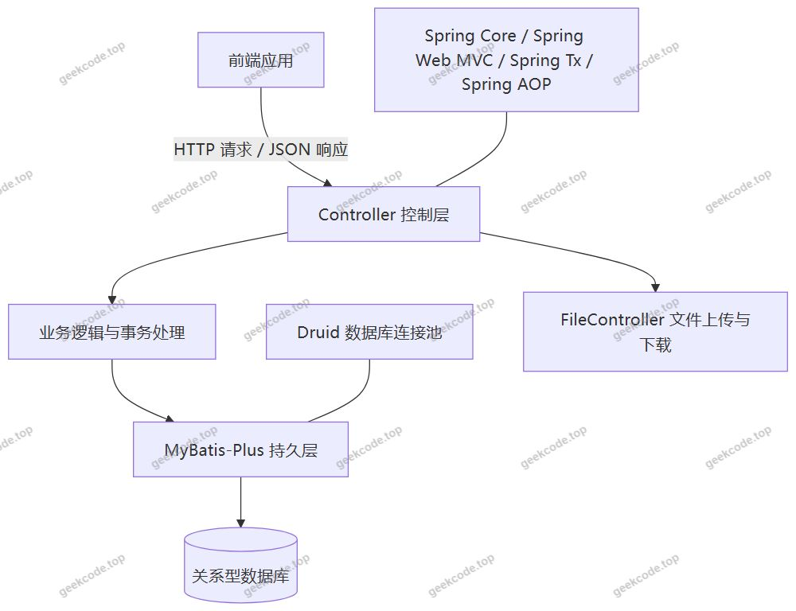
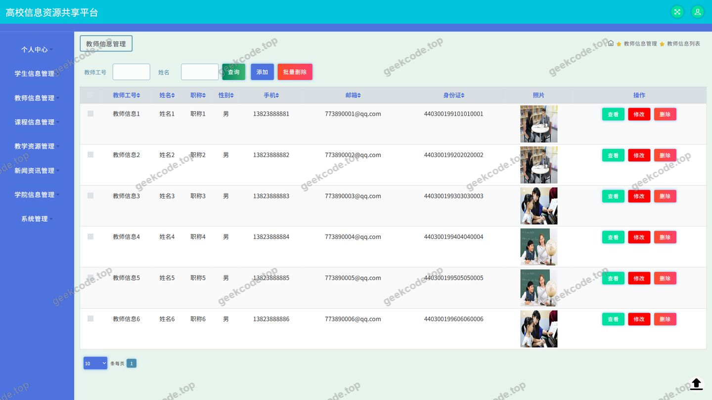
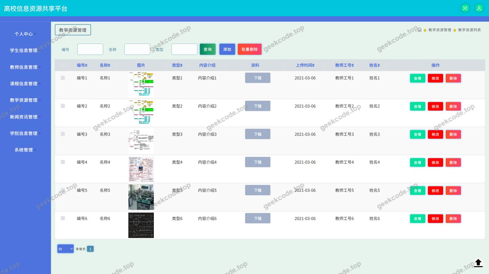
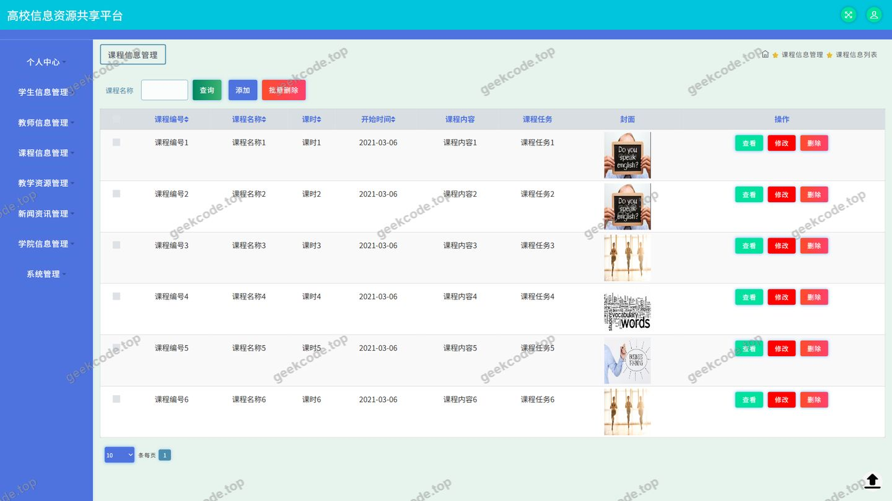
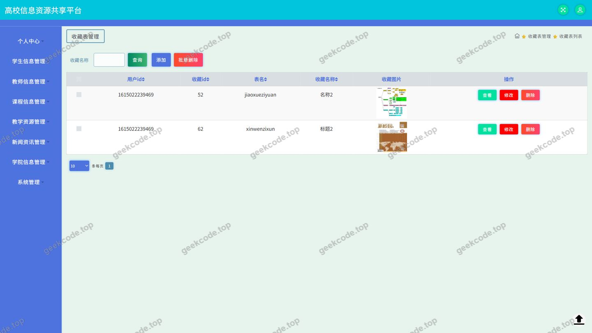
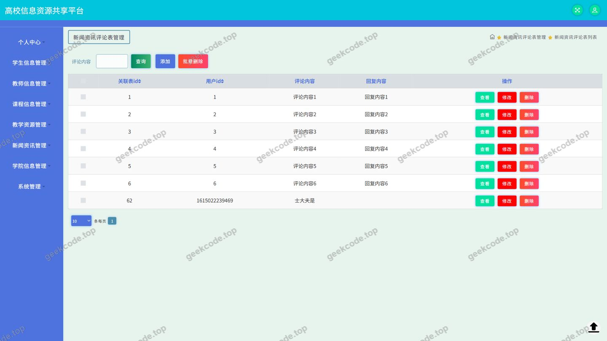
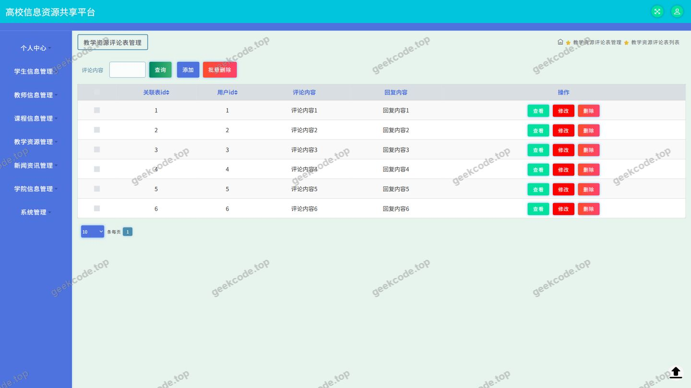
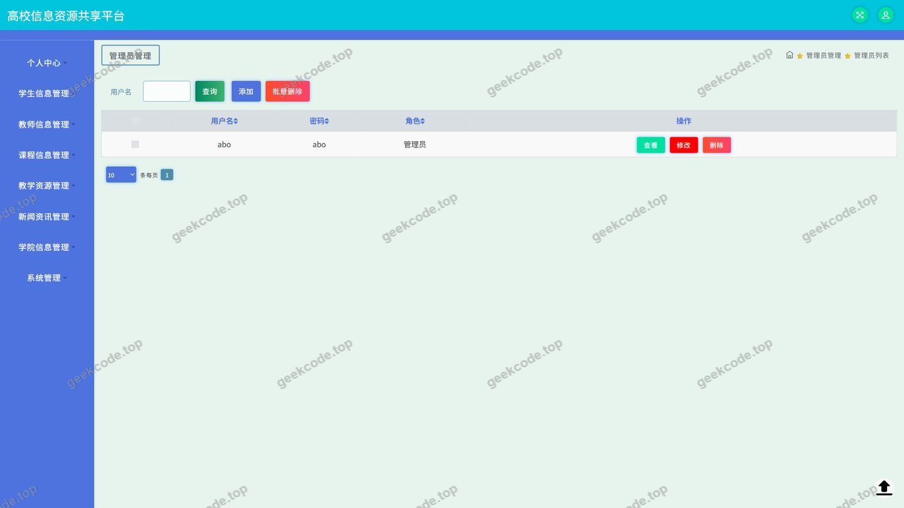

# java项目ssm高校信息资源共享平台java毕业设计

> 🎓 **计算机毕业设计 · java项目ssm高校信息资源共享平台java毕业设计**
>
> 本仓库只放**项目介绍 + 运行截图**（截图是站点带水印的原图，存在仓库 `images/` 里）。
>
> 👉 **完整可运行源码 / 数据库脚本 / 部署文档：[点我获取](https://geekcode.top/archives/java%E9%A1%B9%E7%9B%AEssm%E9%AB%98%E6%A0%A1%E4%BF%A1%E6%81%AF%E8%B5%84%E6%BA%90%E5%85%B1%E4%BA%AB%E5%B9%B3%E5%8F%B0java%E6%AF%95%E4%B8%9A%E8%AE%BE%E8%AE%A1?utm_source=github)**
>
> 💬 咨询微信：**ir9372**　|　🌐 更多项目：[极客代码 geekcode.top](https://geekcode.top/?utm_source=github)
>
> 📌 项目详情页：<https://geekcode.top/archives/java%E9%A1%B9%E7%9B%AEssm%E9%AB%98%E6%A0%A1%E4%BF%A1%E6%81%AF%E8%B5%84%E6%BA%90%E5%85%B1%E4%BA%AB%E5%B9%B3%E5%8F%B0java%E6%AF%95%E4%B8%9A%E8%AE%BE%E8%AE%A1?utm_source=github>

<table><td width="230" align="center"> <b>扫码加微信 ir9372</b></td><td valign="middle">📦 源码 = 项目介绍 + 全部运行截图 + 数据库 + 部署文档 👉 点上方任意截图，直接跳到 <b>极客代码 geekcode.top</b> 详情页</td></table>

---

<h1>java项目_ssm高校信息资源共享平台_java毕业设计</h1>
<h2>项目概述</h2>

高校信息资源共享平台是一个面向高校师生、以教学资源共建共享为核心目标的信息化系统后端工程，采用 SSM（Spring + Spring MVC + MyBatis-Plus）体系构建，对外以纯 API 形式提供 JSON 数据服务。平台围绕高校日常教学场景，汇聚课程信息、教学资源、学习教材、教师信息与新闻资讯等核心数据，并为用户提供登录认证、资源检索浏览、评论互动、内容收藏、个人中心、文件上传下载等能力。平台使用者主要包括在校学生、教师以及系统管理员：学生可查询课程与教学资源、参与评论留言、收藏感兴趣的内容；教师可查看与维护教师信息、上传教学资源；管理员负责用户与系统配置、各业务数据的后台维护。系统采用前后端分离设计，服务端专注数据与业务逻辑处理，通过 Spring 容器统一管理组件、Spring MVC 承载请求分发、MyBatis-Plus 完成数据持久化、Druid 提供高效数据库连接池支持，具备良好的可维护性与可扩展性。

<h2>技术架构</h2>
<h3>整体架构</h3>

平台采用典型的前后端分离架构。服务端为纯 API 工程，所有业务能力通过 Controller 暴露 HTTP 接口，返回结构化数据（如 JSON）供前端消费；前端为独立部署的应用工程，负责页面渲染与交互。服务端内部遵循分层设计：控制层接收请求并做参数校验，业务层组织业务规则与事务，持久层通过 MyBatis-Plus 完成对象与关系数据的映射。

<h3>分层职责</h3>
<ul>
<li><strong>Spring Core / Spring Context</strong>：负责 IoC 容器与依赖注入，统一装配 Controller、Service、Mapper 等组件。</li>
<li><strong>Spring Web MVC</strong>：承担请求路由、参数绑定与响应输出，是平台对外提供 API 的入口。</li>
<li><strong>Spring Tx</strong>：以声明式事务管理业务方法的数据一致性。</li>
<li><strong>Spring AOP</strong>：用于横切逻辑的统一织入。</li>
<li><strong>spring-jdbc 与 MyBatis-Plus</strong>：MyBatis-Plus 在 MyBatis 基础上提供通用 CRUD、条件构造器等能力，显著减少样板化 SQL 与 Mapper 代码。</li>
<li><strong>Druid</strong>：作为数据库连接池，负责连接复用、监控与性能保障。</li>
</ul>
<h3>数据库设计要点</h3>

结合 Controller 列表与页面功能可以确认，平台数据模型覆盖以下主要实体：

<table>
<thead>
<tr>
<th>实体</th>
<th>对应控制层</th>
<th>说明</th>
</tr>
</thead>
<tbody><tr>
<td>用户</td>
<td>UserController</td>
<td>身份认证与账号信息</td>
</tr>
<tr>
<td>教师信息</td>
<td>JiaoshixinxiController</td>
<td>教师档案数据</td>
</tr>
<tr>
<td>课程信息</td>
<td>KechengxinxiController</td>
<td>课程基础数据</td>
</tr>
<tr>
<td>教学资源</td>
<td>JiaoxueziyuanController</td>
<td>教学资源条目及其评论</td>
</tr>
<tr>
<td>学习教材</td>
<td>由评论控制器关联</td>
<td>教材数据及评论</td>
</tr>
<tr>
<td>新闻资讯</td>
<td>XinwenzixunController</td>
<td>资讯内容及其评论</td>
</tr>
<tr>
<td>收藏</td>
<td>StoreupController</td>
<td>用户对内容的收藏记录</td>
</tr>
<tr>
<td>系统配置</td>
<td>ConfigController</td>
<td>平台配置项</td>
</tr>
<tr>
<td>通用数据</td>
<td>CommonController</td>
<td>公共查询与通用能力</td>
</tr>
</tbody></table>

数据库设计遵循以下要点：一是为每类业务实体建立独立数据表，表间通过外键式关联字段（如资源编号、用户编号）建立联系，保证数据边界清晰；二是评论数据按业务对象拆分为教学资源评论、新闻资讯评论、学习教材评论三类，便于针对性查询与展示；三是收藏数据统一由 Storeup 相关接口管理，形成跨业务对象的通用收藏能力；四是配置类数据集中存放，便于在不修改代码的前提下调整平台运行参数。

<h3>技术选型理由</h3>
<ol>
<li><strong>SSM 组合成熟稳定</strong>：Spring 生态的 IoC 与 AOP 为工程提供了良好的解耦能力，配合 Spring MVC 的请求处理模型，适合教学型与管理型系统的开发。</li>
<li><strong>MyBatis-Plus 提升开发效率</strong>：在保留 SQL 可控性的同时，提供通用 Mapper 与条件构造器，减少重复代码，便于快速迭代。</li>
<li><strong>Druid 连接池</strong>：具备稳定的连接管理与监控能力，适合承载多用户并发访问的信息共享类应用。</li>
<li><strong>纯 API 架构便于多端复用</strong>：服务端只输出数据接口，前端页面、移动端或第三方系统均可复用同一套接口，扩展成本低。</li>
<li><strong>JUnit 单元测试</strong>：依赖中引入 JUnit，用于对核心业务逻辑与数据访问进行测试验证，保障代码质量。</li>
</ol>
<h2>功能模块</h2>
<h3>前台用户端</h3>
<ol>
<li><strong>登录认证模块</strong>：提供用户登录入口，完成身份校验后进入平台，是所有业务功能的前置环节。</li>
<li><strong>课程信息模块</strong>：展示课程列表与课程详情，支持用户按课程浏览相关教学安排与说明。</li>
<li><strong>教学资源模块</strong>：展示教学资源列表与详情，用户可查看资源信息并参与评论互动。</li>
<li><strong>学习教材模块</strong>：提供学习教材数据展示，用户可对教材内容进行评论交流。</li>
<li><strong>新闻资讯模块</strong>：发布与展示平台新闻资讯，用户可阅读资讯详情并发表评论。</li>
<li><strong>教师信息模块</strong>：展示教师信息，供学生了解授课教师的基本情况。</li>
<li><strong>评论互动模块</strong>：包含教学资源评论、新闻资讯评论、学习教材评论三类评论接口，支撑用户围绕不同内容对象进行留言与交流。</li>
<li><strong>收藏模块</strong>：由 Storeup 相关接口实现，用户可对感兴趣的资源或资讯进行收藏与取消收藏。</li>
<li><strong>个人中心模块</strong>：展示与维护个人账号信息，并集中管理&quot;我的收藏&quot;等个性化数据。</li>
<li><strong>文件模块</strong>：由 FileController 提供文件上传与下载能力，用于教学资源、教材等附件类内容的传输。</li>
<li><strong>通用与配置模块</strong>：CommonController 提供公共查询与通用能力，ConfigController 提供平台配置项读取。</li>
</ol>
<h3>后台管理端</h3>

根据现有信息，本项目为纯 API 工程，未提供独立的后台前端路由（后台路由为空）。管理类操作不通过独立后台页面承载，而是由各业务 Controller 提供的接口完成数据维护，具体包括：

<ol>
<li><strong>用户管理</strong>：通过 UserController 对用户账号数据进行维护。</li>
<li><strong>教师信息管理</strong>：通过 JiaoshixinxiController 维护教师档案数据。</li>
<li><strong>课程信息管理</strong>：通过 KechengxinxiController 维护课程数据。</li>
<li><strong>教学资源管理</strong>：通过 JiaoxueziyuanController 维护教学资源数据。</li>
<li><strong>新闻资讯管理</strong>：通过 XinwenzixunController 维护资讯内容的发布与更新。</li>
<li><strong>评论管理</strong>：通过 DiscussjiaoxueziyuanController、DiscussxinwenzixunController、DiscussxuexijiaocaiController 分别管理教学资源评论、新闻资讯评论与学习教材评论。</li>
<li><strong>收藏数据管理</strong>：通过 StoreupController 管理收藏记录。</li>
<li><strong>系统配置管理</strong>：通过 ConfigController 维护平台配置参数。</li>
<li><strong>公共数据接口</strong>：通过 CommonController 提供通用查询能力，供各业务模块复用。</li>
</ol>

各管理接口的具体权限划分与按钮级控制，根据现有信息无法确定。

<h2>用户角色与权限</h2>

结合截图功能列表（登录、学生信息、教师信息、用户、课程信息、教学资源、新闻资讯评论、学习教材评论、收藏）与接口信息，平台涉及以下角色：

<h3>学生角色</h3>
<ul>
<li>可通过登录页面完成身份认证进入平台。</li>
<li>可访问课程信息模块，浏览课程列表与详情。</li>
<li>可访问教学资源模块，查看教学资源内容。</li>
<li>可访问新闻资讯模块，阅读资讯并发表评论。</li>
<li>可参与学习教材相关内容的学习与评论互动。</li>
<li>可访问教师信息模块，查看教师信息。</li>
<li>可对内容进行收藏，并在个人中心查看&quot;我的收藏&quot;。</li>
<li>可在个人中心维护个人账号信息。</li>
</ul>
<h3>教师角色</h3>
<ul>
<li>可通过登录页面完成身份认证进入平台。</li>
<li>可访问教师信息模块，查看教师信息相关数据。</li>
<li>可访问课程信息模块与教学资源模块，查看课程与教学资源内容。</li>
<li>可上传教学资源相关文件，参与资源建设。</li>
<li>可围绕教学资源、新闻资讯、学习教材发表评论。</li>
<li>可进行内容收藏并管理个人中心信息。</li>
</ul>
<h3>管理员角色</h3>
<ul>
<li>可通过登录页面完成身份认证进入平台。</li>
<li>可访问用户管理功能，对平台用户数据（对应&quot;页面-用户&quot;）进行维护。</li>
<li>可访问学生信息与教师信息相关数据，进行信息核对与维护。</li>
<li>可对课程信息、教学资源、新闻资讯等业务数据进行增删改查维护。</li>
<li>可对教学资源评论、新闻资讯评论、学习教材评论进行管理。</li>
<li>可管理收藏记录数据。</li>
<li>可维护系统配置项，调整平台运行参数。</li>
<li>可使用文件上传与下载能力管理平台附件资源。</li>
</ul>

三类角色在登录认证、内容浏览、评论互动、收藏与个人中心等基础能力上保持一致，差异主要体现在数据维护与管理类操作上。

<h2>项目特色与创新点</h2>
<ol>
<li>
<strong>面向高校教学场景的资源共享定位</strong>：平台将课程信息、教学资源、学习教材、教师信息与新闻资讯整合到统一的服务端，形成围绕教学活动的信息聚合入口，减少资源分散带来的获取成本。

</li>
<li>
<strong>纯 API 架构支撑多端复用</strong>：服务端不绑定具体前端实现，只输出结构化数据接口，前端页面可独立开发与迭代，后期扩展移动端或其他终端时无需改动服务端业务逻辑。

</li>
<li>
<strong>细粒度的评论体系设计</strong>：不同于集中式评论表设计，平台为教学资源、新闻资讯、学习教材分别建立独立的评论控制器，使评论数据的归属清晰、查询高效，也便于针对不同内容类型制定差异化的互动策略。

</li>
<li>
<strong>统一的收藏能力</strong>：由 Storeup 模块统一承载收藏功能，使用户的个性化数据在个人中心集中呈现，避免各类内容各自实现收藏逻辑带来的重复开发。

</li>
<li>
<strong>MyBatis-Plus 与 Druid 的组合提升工程效率与稳定性</strong>：MyBatis-Plus 降低了持久层样板代码量，Druid 保障了数据库连接的高效复用，二者结合在开发效率与运行稳定性之间取得平衡。

</li>
<li>
<strong>以控制层为清晰边界的模块划分</strong>：从 CommonController 到各业务 Controller，控制层边界与业务实体一一对应，职责明确，便于后续功能扩展与问题定位。

</li>
</ol>
<h2>部署环境</h2>
<h3>服务端运行环境</h3>
<table>
<thead>
<tr>
<th>类别</th>
<th>要求</th>
</tr>
</thead>
<tbody><tr>
<td>JDK</td>
<td>JDK 1.8 及以上版本</td>
</tr>
<tr>
<td>构建工具</td>
<td>Maven 3.6 及以上</td>
</tr>
<tr>
<td>Web 容器</td>
<td>Tomcat 8.5 / 9.0（项目依赖为 spring-webmvc 等传统 Web 组件，采用外部容器部署方式）</td>
</tr>
<tr>
<td>数据库</td>
<td>MySQL 关系型数据库（配合 Druid 连接池与 MyBatis-Plus 使用）</td>
</tr>
<tr>
<td>连接池</td>
<td>Druid，通过 Maven 依赖引入，随应用启动加载，无需单独安装</td>
</tr>
<tr>
<td>单元测试</td>
<td>JUnit，随 Maven 依赖引入</td>
</tr>
<tr>
<td>开发工具</td>
<td>IntelliJ IDEA 或 Eclipse</td>
</tr>
</tbody></table>
<h3>前端运行环境</h3>

项目为纯 API 工程，服务端不包含页面渲染代码。配套前端为独立工程，运行需要：

<table>
<thead>
<tr>
<th>类别</th>
<th>要求</th>
</tr>
</thead>
<tbody><tr>
<td>运行环境</td>
<td>Node.js 及配套包管理工具，用于前端依赖安装与工程构建</td>
</tr>
<tr>
<td>浏览器</td>
<td>支持现代前端框架的主流浏览器（Chrome、Edge 等）</td>
</tr>
</tbody></table>
<h3>部署步骤要点</h3>
<ol>
<li>在 MySQL 中创建平台数据库，并导入项目提供的数据库脚本。</li>
<li>修改服务端数据源配置，填写正确的数据库连接地址、用户名与密码，确保 Druid 连接池可正常初始化。</li>
<li>使用 Maven 执行依赖下载与工程打包。</li>
<li>将打包产物部署至 Tomcat 容器并启动服务，确认各 Controller 接口可正常响应。</li>
<li>启动前端工程并将其接口基地址指向服务端部署地址，完成前后端联调。</li>
</ol>
<h2>五、技术特性</h2>
<ul>
<li>使用 MyBatis-Plus 简化数据访问层开发</li>
</ul>
<h2>六、功能模块截图</h2>
<h3>后台管理端</h3>
<h4>页面-登录</h4>

<h4>页面-教师信息</h4>

<h4>页面-教学资源</h4>

<h4>页面-课程信息</h4>

<h4>页面-收藏</h4>

<h4>页面-新闻资讯评论</h4>

<h4>页面-学生信息</h4>

<h4>页面-学习教材评论</h4>

<h4>页面-用户</h4>

---

## 获取完整源码

| 项目 | 说明 |
| --- | --- |
| 项目名 | java项目ssm高校信息资源共享平台java毕业设计 |
| 运行截图 | 本文 10 张（站点带水印原图，仓库 `images/` 目录） |
| 完整源码 | [https://geekcode.top/archives/java%E9%A1%B9%E7%9B%AEssm%E9%AB%98%E6%A0%A1%E4%BF%A1%E6%81%AF%E8%B5%84%E6%BA%90%E5%85%B1%E4%BA%AB%E5%B9%B3%E5%8F%B0java%E6%AF%95%E4%B8%9A%E8%AE%BE%E8%AE%A1?utm_source=github](https://geekcode.top/archives/java%E9%A1%B9%E7%9B%AEssm%E9%AB%98%E6%A0%A1%E4%BF%A1%E6%81%AF%E8%B5%84%E6%BA%90%E5%85%B1%E4%BA%AB%E5%B9%B3%E5%8F%B0java%E6%AF%95%E4%B8%9A%E8%AE%BE%E8%AE%A1?utm_source=github) |
| 咨询微信 | **ir9372**（备注：jingpin-yuanma） |
| 更多项目 | [极客代码 geekcode.top](https://geekcode.top/?utm_source=github) |

> 需要源码、部署、改配置、跑不起来等问题，加微信 ir9372 沟通，说明项目名即可。
